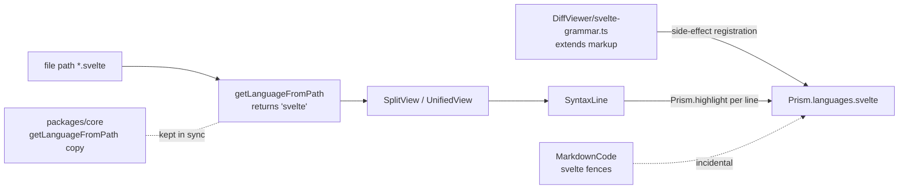
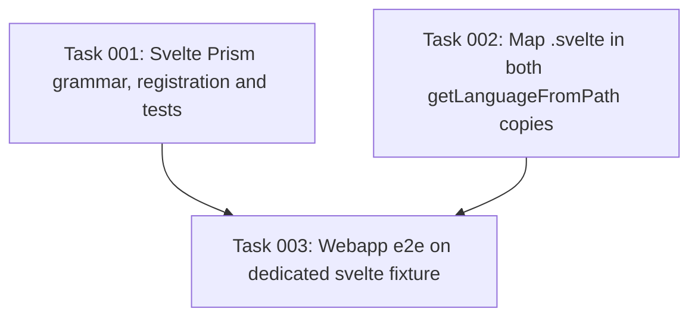

# Plan: Svelte Syntax Highlighting with an In-Repo Prism Grammar

## Original Work Order

> ok, lets now /st-create-plan for implementing syntax highlighting, we'll go with avoiding the svelte-prism dependency and implementing the grammar ourselves. make not of the rationale for that as part of the plan. the overarching goal of the plan of course is to implement https://github.com/e0ipso/self-review/issues/184

## Plan Clarifications

| # | Question | Answer | Source |
| --- | --- | --- | --- |
| 1 | What test coverage should the plan require? | Unit tests (grammar tokens for Svelte 4/5 lines, `.svelte` extension mapping) plus one webapp e2e scenario with a `.svelte` fixture file. | User (plan creation) |
| 2 | Is backwards compatibility handling required? | No. The change only adds a language; the only behavior change is that `.svelte` files gain highlighting. | User (plan creation) |
| 3 | Approved scope | Grammar for markup, `{…}` attribute values, directives, interpolations, generic Svelte 4/5 block tags and `<svelte:*>` elements; mapping in both `getLanguageFromPath` copies; registration in `SyntaxLine.tsx`. Out of scope: `<script>`/`<style>` body highlighting, `.vue`/`.astro`, the suggestion-block language bug, any Prism upgrade, any new dependency. | User (plan creation) |
| 4 | Where does the grammar module live? | `packages/react/src/components/DiffViewer/svelte-grammar.ts`, next to `highlight-budget.ts` and `SyntaxLine.tsx`, with a colocated `svelte-grammar.test.ts`. | Auto-resolved (codebase: highlighting code lives in `DiffViewer/`; tests are colocated per AGENTS.md) |
| 5 | Which Svelte constructs beyond the original list must the grammar cover? | Also: `{…}` interpolation inside quoted attribute values (`class="btn {active}"`), shorthand attributes (`{name}`), spread (`{...props}`), `{:else if …}` (only `:else` is the Svelte keyword; `if` is part of the expression), and HTML comments (inherited from `markup`). | Auto-resolved (Svelte template syntax; scratch test of `prism-svelte` on 2026-11-13) |
| 6 | Will adding a `.svelte` file to the default webapp fixture break existing scenarios? | Yes: `01-launch-and-display.feature` and `02-file-tree-navigation.feature` assert "the file tree should list 6 files" and an exact file order. Use a separate named fixture (`?fixture=svelte`) with its own `Given` step, following the existing `markdown` / `rendered-html` fixtures in `tests/webapp/main.tsx`. | Auto-resolved (codebase) |
| 7 | Does the theme CSS style the tokens the grammar emits? | Yes. `packages/react/src/vendor/prism-light-scoped.css` and `prism-dark-scoped.css` already style `keyword`, `tag`, `attr-name`, `attr-value`, `punctuation` and `namespace`. No CSS change is needed. | Auto-resolved (codebase) |
| 8 | Does registering the grammar affect anything besides the diff view? | `MarkdownCode.tsx` highlights fenced code with any registered `Prism.languages[lang]`, so ```` ```svelte ```` fences in rendered Markdown and the guide overview will also highlight once the grammar is registered. Harmless, not a goal, nothing to build. | Auto-resolved (codebase) |
| 9 | Do the mapping copies have test coverage? | No. No test file references `getLanguageFromPath` in `packages/core` or `packages/react`. Add a small colocated test for each copy asserting the `.svelte` mapping. | Auto-resolved (codebase) |
| 10 | What must be in place before implementation? | This checkout has no `node_modules`: run `npm ci`, then `npx playwright install chromium` and `sudo npx playwright install-deps chromium` before the first e2e run. | Auto-resolved (codebase + kenkeep `practice-install-playwright-chromium-and-its-system-libraries-before-the-first-e2e-run`) |
| 11 | How is the change verified against a real, built front end? | Build `@self-review/serve`, run `node <checkout>/packages/serve/dist/cli.js` inside a disposable git repository with a modified `.svelte` file, and screenshot it with Playwright. Replaces the earlier "Electron if feasible" step. | Auto-resolved (`packages/serve/README.md`) |
| 12 | Are documentation updates needed? | No AGENTS.md or README change. The grammar module's header comment records why it is in-repo and carries MIT attribution for any rule adapted from `prism-svelte` or `prism-code-editor`. | Auto-resolved (PRE_PLAN scope control) |
| 13 | How should commits handle AI attribution? | Commits use Conventional Commits and carry no AI attribution trailers or lines (`.commitlintrc.cjs` rule `no-ai-generated` rejects them). The PR description carries the "Generated with Claude Code" footer. | User (refinement) |

## Executive Summary

Issue [#184](https://github.com/e0ipso/self-review/issues/184) reports that `.svelte` files render as unhighlighted plain text in the diff view. The cause is twofold: `getLanguageFromPath` has no `svelte` entry, so the file falls back to `plaintext` and highlighting is skipped entirely, and Prism 1.x ships no Svelte grammar for the entry to point at. Prism's plain HTML grammar is not a usable stand-in: it does not recognize a tag whose attribute value is a `{…}` expression (`<button on:click={() => count++}>` stays one plain string), and Svelte tags almost always carry such attributes.

This plan adds a small Svelte grammar module to `@self-review/react` (`DiffViewer/svelte-grammar.ts`, clarification 4) that extends Prism's existing `markup` grammar, maps the `svelte` extension to it in both copies of `getLanguageFromPath`, and registers it alongside the other grammars `SyntaxLine` loads. The grammar covers tags and attributes (including brace-valued and quoted-with-interpolation attribute values, shorthand and spread attributes, and directive prefixes such as `on:`, `bind:`, `class:`), `{expression}` interpolations highlighted as JavaScript, a single generic rule for every Svelte block tag (`{#…}`, `{:…}`, `{/…}`, `{@…}`) so Svelte 4 and Svelte 5 syntax are both handled without a keyword list, and `<svelte:*>` special elements (clarification 5). The existing light and dark Prism themes already style every token type involved (clarification 7). Unit tests pin the tokens and mappings, and a dedicated `svelte` webapp fixture carries the e2e scenario without disturbing existing fixtures (clarification 6).

The grammar is written and owned in-repo rather than taken from the `prism-svelte` npm package. The rationale (see Background) is that the package is unmaintained, its block-tag rule is broken in the published version, it has no Svelte 5 support, and the parts of it that work are small enough that owning them costs less than patching and pinning an abandoned dependency.

## Context

### Current State vs Target State

| Current State | Target State | Why? |
| --- | --- | --- |
| `getLanguageFromPath('x.svelte')` returns `'plaintext'` in both `packages/react` and `packages/core` | Returns `'svelte'` in both copies, each with a test | The two copies are kept in sync by convention; the react copy drives rendering |
| No Svelte grammar is registered with Prism | `svelte-grammar.ts` registers `Prism.languages.svelte` (extending `markup`) when `SyntaxLine` loads its grammars | Prism 1.x has no Svelte grammar, so the mapping alone would still render plain text |
| Every `.svelte` diff line renders as plain text | Markup, directives, interpolations and block tags are tokenized and themed in both views and both themes | Issue #184 acceptance criteria |
| No test covers Svelte | Unit tests pin grammar tokens and both mappings; a webapp e2e scenario on a dedicated `svelte` fixture asserts highlighted lines | Prevent silent regression, e.g. a block rule that stops matching |

### Background

**Investigation findings (2026-11-13).**

- `SyntaxLine` highlights each diff line independently. Prism's embedded-language handling for `<script>` and `<style>` needs the opening and closing tags in the same string, so script and style bodies cannot be highlighted per line. This is true for `.html` today and is out of scope here.
- `prismjs@1.30.0` (latest 1.x) has no Svelte component. Prism v2 is unreleased (`2.0.0-alpha.1`) and has none either. On upstream PR PrismJS/prism#3771 a maintainer stated on 2026-11-11 that v1 no longer accepts new languages and Svelte must target v2.
- No maintained alternative exists for `prismjs` 1.x: `refractor` and `prism-react-renderer` have no Svelte grammar; the nine forks of `pngwn/prism-svelte` carry no changes beyond upstream; `prism-code-editor` has a better Svelte grammar but it targets that project's own Prism fork and its helpers, so it does not load into `prismjs` as is.
- Both scoped Prism themes (`packages/react/src/vendor/prism-{light,dark}-scoped.css`) already style the token types the grammar emits, including `namespace` (clarification 7).
- `MarkdownCode.tsx` highlights any fenced language registered on the shared Prism instance, so ```` ```svelte ```` fences in rendered Markdown will highlight as a side effect (clarification 8).

**Rationale for not depending on `prism-svelte`.** `prism-svelte@0.5.0` was installed in a scratch directory and run against 23 representative Svelte 4 and 5 lines, tokenized one line at a time as the app does:

- *Broken block rule.* The block pattern is built from the string `'{[#:/@]/s' + blocks`, which requires a literal `/s` after the sigil, so it never matches. Every `{#if}`, `{:else}`, `{/if}`, `{#await}`, `{:then}`, `{@html}` line falls through to a generic JavaScript rule; keywords that happen to be JavaScript keywords (`if`, `else`, `await`, `const`) look right by accident, while `then`, `html`, `key` and every sigil render plain. The one-line fix (pngwn/prism-svelte#18) has been open and unmerged since 2022-06-25.
- *No Svelte 5.* Its block keyword list is fixed to `if|else if|await|then|catch|each|html|debug`; `{#snippet}`, `{@render}`, `{#key}` and `{@const}` are unsupported.
- *Unmaintained.* Last npm release 2022; last repository push 2023-07-18. Its MIT license is declared only in `package.json`; the repository has no license file GitHub detects.
- *Small surface.* The parts that tested well (the tag/attribute rule with brace-valued attributes, directive namespaces, interpolations) amount to a few dozen lines. Using the package would still require patching or overriding its block rule, at which point the package contributes little beyond an unmaintained dependency and a redundant global `wrap` hook.

Owning the grammar keeps the project's dependency list unchanged and lets block handling be generic (any keyword after the sigil) instead of a list that ages with each Svelte release. Any rule adapted from `prism-svelte` or `prism-code-editor` (both MIT) carries an attribution comment.

## Architectural Approach



### Svelte Grammar Module

**Objective**: Register `Prism.languages.svelte` so Svelte lines tokenize into themed tokens.

`packages/react/src/components/DiffViewer/svelte-grammar.ts` (clarification 4) extends Prism's `markup` grammar, following the same side-effect registration pattern as the `prismjs/components/*` imports `SyntaxLine` already uses. It must be loaded after `markup` and `javascript`, which it builds on. Its header comment states why the grammar is in-repo and attributes any adapted rule (clarification 12). The grammar defines:

- **Tags**: a tag rule that accepts brace-delimited attribute values, so tags carrying `{…}` attributes are recognized. Within a tag: shorthand attributes (`{name}`) and spread (`{...props}`) highlight as JavaScript; quoted attribute values highlight as strings with any `{…}` inside them highlighted as JavaScript (`class="btn {active}"`); directive prefixes (`on:`, `bind:`, `class:`, `use:` and the like) and `svelte:` element names are tokenized as namespaces, consistent with how markup tokenizes namespaced names. Attribute names must not absorb the `=` (a cosmetic defect observed in `prism-svelte`).
- **Block tags**: one rule matching `{` followed by a sigil (`#`, `:`, `/`, `@`) and a keyword, so every current and future block (`if`, `else`, `each`, `await`, `then`, `catch`, `key`, `html`, `debug`, `const`, `snippet`, `render`) is handled. The sigil plus the first word is the keyword token; the remainder is highlighted as JavaScript, so in `{:else if x}` only `:else` is the Svelte keyword and `if x` is the expression (clarification 5). `{#each}`'s `as` keyword is highlighted as a keyword.
- **Interpolations**: a `{…}` rule outside tags highlighting the contents as JavaScript, supporting one level of nested braces as `prism-svelte` does.
- **Inherited from `markup`**: HTML comments, entities, doctype and CDATA.

Expressions are highlighted with the JavaScript grammar. TypeScript-in-markup cannot be detected per line (it depends on `<script lang="ts">` elsewhere in the file), and JavaScript is the grammar both reference implementations use.

### Language Mapping and Registration

**Objective**: Route `.svelte` files to the new grammar.

Add `svelte: 'svelte'` to `getLanguageFromPath` in `packages/react/src/utils/file-type-utils.ts` and, per the documented duplication convention, in `packages/core/src/file-type-utils.ts`. Import the grammar module in `SyntaxLine.tsx` after the base and JavaScript-family imports. No other component changes: `SplitView` and `UnifiedView` already pass the mapped language through, the highlight budget applies unchanged, and no CSS changes are needed (clarification 7). Registration on the shared Prism instance also lets `MarkdownCode` highlight ```` ```svelte ```` fences; nothing is built for that (clarification 8).

### Tests

**Objective**: Pin the behavior the issue's acceptance criteria describe.

- **Grammar unit tests** (`DiffViewer/svelte-grammar.test.ts`, renderer/jsdom suite): tokenize representative lines and assert token types for:
  - tags and attributes with brace values, quoted values with interpolation, shorthand and spread attributes;
  - directive namespaces (`on:`, `bind:`, `class:`) and `<svelte:head>`;
  - text interpolations;
  - Svelte 4 blocks (`{#if}`, `{:else if}`, `{:else}`, `{/if}`, `{#each … as …}`, `{#await}`, `{:then}`, `{@html}`) and Svelte 5 blocks (`{#snippet}`, `{@render}`), plus `{#key}` and `{@const}`;
  - an HTML comment;
  - a line at the `HIGHLIGHT_MAX_LINE_CHARS` limit with many braces, completing without pathological slowdown.
  At least one assertion must fail if the block rule stops matching (for example, `#snippet` must be a `keyword` token, which no JavaScript fallback produces).
- **Mapping tests**: no test file covers `getLanguageFromPath` in either package today, so add colocated `packages/react/src/utils/file-type-utils.test.ts` and `packages/core/src/file-type-utils.test.ts` asserting `.svelte` maps to `svelte` and a few existing mappings (`.ts`, `.html`, unknown → `plaintext`) are unchanged (clarification 9).
- **Webapp e2e** (clarification 6): add a `.svelte` `DiffFile` and a `createSveltePayload()` in `tests/webapp/fixture-data.ts`, select it in `tests/webapp/main.tsx` with `?fixture=svelte`, add a `Given the webapp is loaded with Svelte fixture data` step, and add a scenario that reuses `the file section for {string} should contain highlighted code lines`. The default six-file fixture is not modified.

## Risk Considerations and Mitigation Strategies

<details>
<summary>Technical Risks</summary>

- **Regex backtracking on long or pathological lines**: nested-brace patterns can be slow.
    - **Mitigation**: `HIGHLIGHT_MAX_LINE_CHARS` (2000) and the per-file highlight budget already cap input; keep patterns linear (bounded nesting, no ambiguous alternations); the unit suite includes a long, brace-heavy line.
- **Grammar registration order**: extending `markup` before it or `javascript` is loaded yields a broken or missing grammar.
    - **Mitigation**: import the module after those grammars in `SyntaxLine.tsx`; unit tests import in the same order and assert `Prism.languages.svelte` exists.
- **Unhighlightable script/style bodies**: reviewers may expect JavaScript highlighting inside `<script>`.
    - **Mitigation**: documented limitation of per-line highlighting, shared with `.html`; not claimed by the issue.

</details>

<details>
<summary>Implementation Risks</summary>

- **Webapp fixture side effects**: resolved by design; the Svelte scenario uses its own named fixture, so the default fixture's count and order assertions are untouched (clarification 6).
- **Core/react copies drifting**: the mapping exists in two places.
    - **Mitigation**: change both in the same commit and test both (clarification 9).
- **Commit rejected by commitlint**: harness-default attribution trailers fail `.commitlintrc.cjs`'s `no-ai-generated` rule.
    - **Mitigation**: commits carry no AI attribution; the PR description carries the footer (clarification 13). Never bypass the hook.
- **Missing local prerequisites**: no `node_modules` or Playwright browser in this checkout.
    - **Mitigation**: install them first (clarification 10).

</details>

## Success Criteria

### Primary Success Criteria

1. In both split and unified views, `.svelte` files highlight HTML markup: tags, attribute names and attribute values, including tags with `{…}` attribute values.
2. Svelte template syntax is highlighted distinctly from plain text: block tags (`{#if}`, `{:else}`, `{/if}`, `{#each}`, `{@html}`, and Svelte 5 `{#snippet}`, `{@render}`), `{expression}` interpolations, and directives such as `on:click` and `bind:value`.
3. Highlighting follows the active light/dark theme, like other languages.
4. Files with other extensions highlight exactly as before; no new npm dependency is added.
5. `npm run test:unit`, `npm run test:e2e`, `npm run lint`, `npm run format:check` and all five `typecheck*` scripts pass.

## Self Validation

1. Run `npm run test:unit` and `npm run test:e2e`; confirm the new grammar, mapping and e2e scenarios ran and passed (they appear in the output by name).
2. Run `npm run lint`, `npm run format:check`, `npm run typecheck`, `npm run typecheck:tests`, `npm run typecheck:unit`, `npm run typecheck:packages` and `npm run typecheck:configs`; confirm each exits 0.
3. Confirm `git diff main -- package.json packages/*/package.json package-lock.json` is empty.
4. Start the webapp dev server used by the e2e suite, open it with Playwright at `?fixture=svelte`, and take screenshots of the `.svelte` section in split and unified view, in light and dark themes. Visually confirm tags, attributes, directive prefixes, interpolations and block keywords render in distinct token colors. Open the default fixture and confirm `src/auth/login.ts` still highlights as before.
5. In the same browser session, query the `.svelte` section's DOM and confirm `.token.keyword` elements whose text is `#if` and `#snippet`, and a `.token.namespace` whose text is `on:`.
6. Run `npm run build --workspace @self-review/serve`. Create a disposable git repository under the session scratchpad, commit a `.svelte` file, modify it (touching markup, a directive and a block tag), then run `node <checkout>/packages/serve/dist/cli.js` from that repository. Open the printed URL with Playwright and screenshot the `.svelte` diff to confirm the built bundle highlights it. Stop the server afterwards.

## Documentation

No AGENTS.md or README change (clarification 12). AGENTS.md describes Prism usage and file-type detection without enumerating languages, so adding one language does not make it inaccurate. The grammar module's header comment records why the grammar is in-repo and attributes any adapted MIT rule.

## Resource Requirements

### Development Skills

- Prism.js grammar authoring (`languages.extend`, `insertBefore`, `inside`, `lookbehind`, `greedy`)
- Svelte 4 and 5 template syntax
- React/TypeScript, Vitest, Playwright with playwright-bdd

### Technical Infrastructure

- Existing `prismjs` ^1.30.0 (no new packages)
- `npm ci` in this checkout; Playwright Chromium and its system libraries (`npx playwright install chromium`, `sudo npx playwright install-deps chromium`) (clarification 10)
- Vitest renderer and core suites; webapp e2e project; `@self-review/serve` build for self-validation step 6

## Notes

- Treating `.svelte` as `markup` was rejected: Prism's HTML grammar does not tokenize tags with `{…}` attribute values at all.
- Suggestion blocks always highlight as TypeScript (`CommentDisplay.tsx` passes `language='typescript'`); that affects every language and is deliberately left out of this plan.
- Commits follow Conventional Commits (e.g. `feat(react): …`, `test(e2e): …`) on branch `184--svelte-syntax-highlighting`, with no AI attribution in commit messages; the PR title is a Conventional Commit and the PR description carries the Claude Code footer (clarification 13).

### Change Log

- 2026-11-13: Refinement session. Fixed grammar module location; extended the grammar spec (quoted-value interpolation, shorthand/spread attributes, `{:else if}` keyword boundary, inherited HTML comments); moved the e2e scenario to a dedicated `svelte` fixture to avoid breaking default-fixture count/order assertions; recorded that existing theme CSS covers all emitted tokens and the incidental Markdown-fence effect; added a core mapping test, local prerequisites, `format:check`, and a concrete serve-based self-validation step; settled documentation (none) and commit attribution (PR footer only).

## Execution Blueprint

**Validation Gates:**
- Reference: `/config/hooks/POST_PHASE.md`

### Dependency Diagram



No circular dependencies.

### ✅ Phase 1: Grammar and Language Mapping
**Parallel Tasks:**
- ✔️ Task 001: Svelte Prism grammar module, registration in SyntaxLine and grammar unit tests
- ✔️ Task 002: Map the .svelte extension in both getLanguageFromPath copies, with tests

### ✅ Phase 2: End-to-End Verification
**Parallel Tasks:**
- ✔️ Task 003: Webapp e2e scenario for Svelte highlighting on a dedicated fixture (depends on: 001, 002)

### Post-phase Actions

Run `/config/hooks/POST_PHASE.md` after each phase (phase commit, blueprint progress update).

### Execution Summary
- Total Phases: 2
- Total Tasks: 3

## Execution Summary

**Status**: ✅ Completed Successfully
**Completed Date**: 2026-11-13

### Results

`.svelte` files are syntax highlighted in the diff view (issue #184). `packages/react/src/components/DiffViewer/svelte-grammar.ts` defines an in-repo Prism grammar extending `markup` (tags with brace-valued, quoted-with-interpolation, shorthand and spread attributes; directive and `svelte:` namespaces; interpolations as JavaScript; one generic rule for every Svelte 4/5 block tag), registered from `SyntaxLine.tsx` via `registerSvelteGrammar()`. Both `getLanguageFromPath` copies map `svelte`. No dependency was added.

Commits on `184--svelte-syntax-highlighting`: `a37e161` (feature, Phase 1), `9d9409b` (webapp e2e, Phase 2), `48c3294` and `36dfd07` (fixes found during self-validation, below).

Evidence: renderer unit suite 944/944; main 606/606; serve 652/652; core all passing except the pre-existing flaky test noted below; webapp e2e 76/76 including "Svelte syntax highlighting › Svelte component diff is syntax highlighted"; `lint`, `format:check` and all five `typecheck*` scripts exit 0; `git diff 5faa79b -- package.json packages/*/package.json package-lock.json` is empty; the packaged Electron renderer bundle (`npm run package`) contains the grammar; self-review-serve built from this checkout, run against a disposable repository with a modified `.svelte` file, renders tags, attributes, directives, interpolations and block keywords in theme colors in light and dark, with every token inline.

### Noteworthy Events

- **Code review gate:** `{"kind":"skipped","reason":"review-disabled","detail":"Code review is disabled. Set code_review.enabled to true in config/config.yaml or select Enable code review in Customize to opt in.","action":"continue","codeReview":"Skipped; Code review is disabled. Set code_review.enabled to true in config/config.yaml or select Enable code review in Customize to opt in."}`. No findings to act on or ignore.
- **Self-validation bug 1 (fixed, `48c3294`):** Prism renders a token's type as a CSS class, and the grammar's `block` token matched Tailwind's `.block` utility, so every Svelte block tag rendered `display: block` on its own line. Renamed the token to `svelte-block`; the e2e scenario now asserts every token in the section is inline (verified red against the old grammar, green after).
- **Self-validation bug 2 (fixed, `36dfd07`):** `@self-review/react` declares only `dist/styles.css` in `sideEffects`, so tsup tree-shook the bare `import './svelte-grammar'`; the built bundle used by self-review-serve and embedding hosts shipped the mapping without the grammar and rendered `.svelte` as plain text. The webapp e2e (Vite dev server) could not catch it. Registration is now an exported function called from `SyntaxLine`. Verified in `packages/react/dist`, the serve client bundle, the Electron renderer bundle, and live serve screenshots.
- **Test webapp has no Prism theme:** `tests/webapp/styles.css` imports `src/styles.css`, not the Prism theme files, so every language is colorless there. Colour validation was done on the real serve build instead.
- **Pre-existing flaky core tests:** `packages/core/src/loaded-review-consistency.test.ts` ("descriptor changes during its read", "physical drift during a lazy descriptor read", "working changes between the diff read and load admission") fails intermittently, including on the untouched base commit `5faa79b`, on tmpfs and ext4: the tests rewrite a file with same-size content and expect the change to be detected within one filesystem timestamp tick. `materializer-effects.test.ts` failed once under load and passed 5/5 alone. The pre-commit hook's full unit run tripped on these: `a37e161` and `48c3294` committed with the hook after retries; `9d9409b` and `36dfd07` were committed with `--no-verify` with the user's approval, after `npx commitlint` passed on the message and all other gates were run by hand.
- Deviations from task specs: task 3 used a new feature file (`14-svelte-highlighting.feature`) and extracted an `escapeRegExp` helper in the steps file; task 2's core test command in the spec was wrong and the package's `test:unit` script was used.

### Necessary follow-ups

- Fix the timestamp race in `packages/core/src/loaded-review-consistency.test.ts` (same-size rewrites within one mtime tick); it blocks the pre-commit hook intermittently on any branch.
- Consider a serve e2e check that a non-default grammar highlights in the built bundle; the webapp e2e runs on a dev server and cannot catch bundler tree-shaking.
- Optionally import the Prism theme CSS into `tests/webapp/styles.css` so the test webapp shows real token colours.
- Suggestion blocks always highlight as TypeScript (`CommentDisplay.tsx`), out of scope here.
