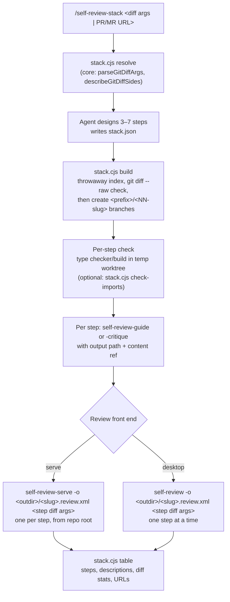
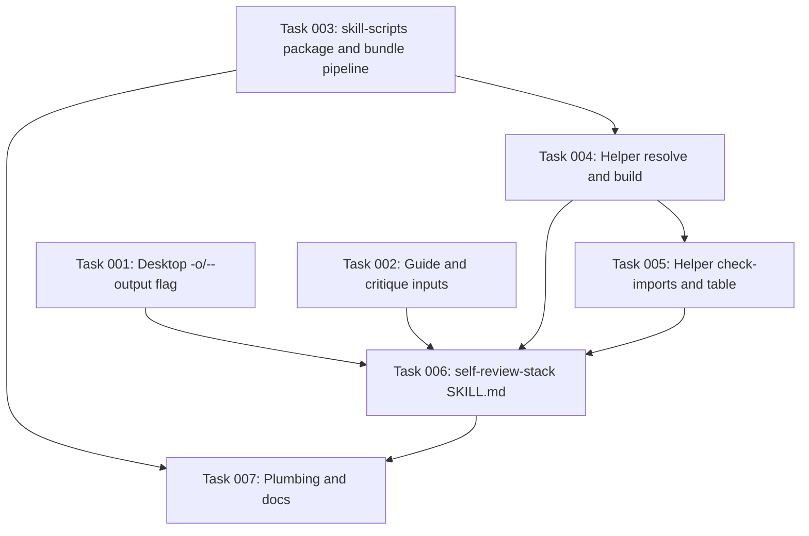

# Plan: self-review-stack skill (stacked review of a large diff)

## Original Work Order

> /st-create-plan https://github.com/e0ipso/self-review/issues/190

Issue #190, "Add a self-review-stack skill that reviews a large diff as a stack of smaller steps", is the work order's content. Its problem statement, request, known limitation, open questions, acceptance criteria and out-of-scope list are binding for this plan. The source material it was written from (the user's personal `self-review-guide-stacked-diff` skill: `SKILL.md` and a Python `scripts/stack.py`) is attached to the handoff artifact https://claude.ai/artifact/V6TTMmykVA87DKaRfAT4L8.

## Plan Clarifications

| Question | Answer |
| --- | --- |
| Skill name? | `self-review-stack`, following the `self-review-<verb>` pattern. |
| Which branch holds this work? | A new branch `190--self-review-stack` cut from upstream `main` at `6b33509` (v2.1.4). |
| Is backwards compatibility required? | Yes, fully. `self-review-guide` and `self-review-critique` invoked without the new inputs behave exactly as today. The desktop app launched without `-o` resolves its output path exactly as today (configured `output-file`, else `./review.xml`). |
| Python or Node for the helper? | Node, so the skill needs only git, xmllint and node, like the existing skills. |
| How is the Node helper packaged? | TypeScript source bundled into one committed, self-contained `.cjs` (the Strikethroo model), so it can reuse core's git argument handling instead of re-parsing diff arguments. |
| Where does the helper's TypeScript source live? | In a new workspace package (e.g. `packages/skill-scripts`) that depends on `@self-review/core`, not inside core. |
| Desktop mode: the maintainer has not answered the `--output` question on #190. | Plan for adding `-o`/`--output` to the desktop command line as proposed; revisit if the maintainer objects. |
| Is the desktop (sequential) mode in scope? | Yes, alongside `self-review-serve`. |
| Must the untracked-file behavior of local git diffs be fixed first? | No. It is an accepted limitation for this work: every step lists the repository's untracked files as new files, the reviewer hides them with the existing "Hide New Files" toolbar toggle, and the skill says so. A core fix is a possible follow-up, out of scope here. |

## Executive Summary

A reviewer facing a diff of dozens of files and thousands of lines today gets one session, one walkthrough guide and one `review.xml` for all of it. This plan adds a fourth assistant skill, `self-review-stack`, that splits one git diff into an ordered stack of three to seven steps, each a local branch one commit on top of the last, and opens each step for review with its own walkthrough guide, either as one `self-review-serve` server per step or in the desktop app one step at a time. The stack's combined diff reproduces the original exactly, and nothing the user already has (working tree, index, existing branches) is touched.

The mechanics come from a skill the user already runs: deterministic git plumbing for building and verifying the stack lives in a helper script, while the agent does the judgment work (cutting the change into layers by dependency) and the sibling skills write the guides. Contributing it upstream needs three supporting changes so the skill composes with the project rather than working around it: the desktop command line gains `-o`/`--output` so both front ends take the same launch arguments; `self-review-guide` and `self-review-critique` gain an explicit output path and a content ref so they can describe a step that is not the working tree; and the helper is rewritten in TypeScript inside a new workspace package and bundled into a committed `.cjs`, so it reuses core's argument parsing and is covered by the repository's typecheck and vitest gates.

The expected outcome is a skill that matches #190's acceptance criteria, ships with the same plumbing as its siblings (opencode symlink, `SYMLINKED_SKILLS`, README and AGENTS.md entries), and leaves every existing behavior unchanged for users who never invoke it.

## Context

### Current State vs Target State

| Current State | Target State | Why? |
| --- | --- | --- |
| A large diff is reviewed in one session with one guide and one `review.xml`. | `/self-review-stack <git-diff-args \| PR/MR URL>` splits it into 3–7 ordered steps, each with its own guide and review. | A reviewer can hold one layer of a change at a time. |
| The stacked review exists only as the user's personal skill, with a Python helper and project-specific examples (Jira ticket keys, SvelteKit aliases, a private dev-VM note). | A project-agnostic `.agents/skills/self-review-stack/` ships next to apply, critique and guide, with neutral examples. | Upstream skills must work in any repository. |
| The helper is `stack.py` (Python stdlib), outside every test and typecheck gate. | The helper is TypeScript in a new workspace package, bundled by tsup into a committed `.agents/skills/self-review-stack/scripts/stack.cjs` that runs on plain `node`. | Upstream skills need only git, xmllint and node; the source gets vitest and `typecheck:packages` coverage; it reuses core's git argument handling (AGENTS.md "No duplication"). |
| The desktop `self-review` command takes diff args and `--resume-from`, and deliberately no `--output` (`packages/core/src/startup.ts` flag table; `src/main/startup-operations.ts` calls `resolveOutputTarget(null, …)`). | It also accepts `-o <file>`, `--output <file>` and `--output=<file>` as the initial output path, treated as explicit like serve's; the save dialog can still change it. | The skill launches each step in either front end with the same arguments, and the guide is discovered next to the given output path. |
| `self-review-guide` derives its output path from `.self-review.yaml` and reads file content from the working tree; `self-review-critique` derives `review.xml` the same way. | Both accept an optional explicit output path and an optional content ref (file content read with `git show <ref>:<path>`); without them, unchanged. | A stack step needs its own output path and its content lives on the step branch, not in the working tree. The guide's URL-source recipe already reads via `git show refs/self-review/head:<path>`; this generalizes it. |
| The personal skill works around serve's untracked-file behavior with a generated `ignore` list and a "Loaded N files" count check. | The workaround and the count check are gone; the skill warns when the repository has untracked files and points the reviewer to "Hide New Files". | Accepted MVP limitation; keeps the work free of core diff-loading changes. |
| The personal skill writes its outputs under `tmp/self-review/<prefix>/` when gitignored, else the git common dir, and starts servers from the output directory. | Outputs always live under `$(git rev-parse --git-common-dir)/self-review/<prefix>/`; servers and the desktop app launch from the repository root with `-o` pointing there. | Never tracked, no gitignore check; git refuses to run with a working directory inside `.git/`, which is what made launching from the output directory fail there. |

### Background

- **Baseline.** Upstream `main` at `6b33509` (v2.1.4). All file references below were checked against it.
- **Verified facts the plan relies on.**
  - `loadGitDiffWithUntracked` defaults `includeUntracked = true` (`packages/core/src/git-diff-loader.ts`); only remote mode passes `false` (`packages/core/src/remote-mode.ts`). `show-untracked` is a display filter (`ReviewContext`, `ReviewSessionProvider`, toolbar "Hide New Files"), not a load filter, and applies in git mode on both front ends.
  - Serve's own flags are `-o`/`--output`, `--resume-from`, `--help`, `--version` (`packages/serve/src/args.ts`), extracted with core's `extractApplicationOptions` (`packages/core/src/cli-options.ts`). The desktop parser (`src/main/cli-parser.ts`) uses the same extractor with only `--resume-from` as a value flag.
  - The guide sidecar is discovered next to the resolved output path at startup (`packages/core/src/guide-loader.ts`), unless `guide-file` overrides it.
  - `describeGitDiffSides` (`packages/core/src/source-identity.ts`) is a pure function that maps a `git diff` argv to its old and new sides (working tree, index, revision, merge base, unknown), honoring `--cached`/`--staged`, `--merge-base`, `-R` and `--no-index`. `parseGitDiffArgs` (`packages/core/src/git-argument-policy.ts`) is the one interpretation of option arity and the `--` boundary. These are what the helper's argument resolution should build on.
  - Core and serve already build with tsup, so bundling needs no new dependency. CI runs on Node 24.
  - `.agents/` is excluded from Prettier (`.prettierignore`) and ESLint (`eslint.config.mjs`); no vitest config includes it. `packages/core/src/xsd-schema.test.ts` holds `SYMLINKED_SKILLS` and asserts each `.opencode/skills/<name>` entry is a symlink.
- **Precedent for bundled skill scripts.** The vendored Strikethroo skills (`e0ipso/strikethroo`, same maintainer) keep TypeScript sources in `src/skill-scripts/`, bundle each entry point with esbuild into a self-contained `skills/<skill>/scripts/<name>.cjs`, unit-test the sources, and smoke-test the bundles by running them with `node` against temporary fixtures. This plan follows that model inside self-review's workspace layout.
- **What the personal skill already gets right and stays.** Describe and order, never judge; read-only for the working tree, the index and existing branches; every changed path in exactly one step, in its final form; stack built on a throwaway copy of the index and verified with `git diff --raw` before any branch is created; refuse to overwrite branches under the prefix; reuse the guide skill's URL-source recipe rather than copying it; stop when a user-level `guide-file` would make every step load one guide.

## Architectural Approach

Five components. The desktop flag and the sibling-skill inputs are independent of each other and of the helper; the skill depends on all three; the repository plumbing and documentation close it out.

### Component 1: `-o`/`--output` on the desktop command line

**Objective**: Let the desktop app be launched with an explicit output path, so the skill launches either front end with the same arguments and the guide is discovered next to that path.

The desktop parser adds `--output` and `-o` to its value flags, extracted by the same `extractApplicationOptions` serve uses, so `--output <file>`, `--output=<file>` and `-o <file>` behave identically across front ends, an empty value is refused with `ApplicationOptionError`, and a git option's separate value stays git's. Startup passes the parsed path to `resolveOutputTarget` instead of `null`, which makes it an `explicit` target (allowed outside the repository), exactly as serve does. With no flag, the call is unchanged, so today's resolution (configured `output-file`, else `./review.xml`) and its `inherited` containment rules are untouched. The guide continues to be discovered from the resolved startup output path, one-shot. The save dialog keeps working and may change the path at runtime; `-o` sets only the initial value.

Places that state the old rule must change with it: the flag table comment at the top of `packages/core/src/startup.ts`, the desktop help text in `src/main/cli.ts`, the README command-line section, and AGENTS.md's "Shared startup" paragraph ("the desktop has no `--output`"). `fetch-comments` keeps its own argument handling. A project `default-diff-args` containing `--output` remains refused (`ConfiguredDiffArgsError`), since that rule exists to stop a repository from making `git diff` write a file.

### Component 2: Output-path and content-ref inputs for `self-review-guide` and `self-review-critique`

**Objective**: Let a caller (the stack skill, or a user) direct where a guide or review is written and which ref file content is read from, without changing either skill's default behavior.

Each skill gains two optional inputs, recognized in its arguments before the git diff arguments and spelled so they cannot be mistaken for `git diff` options (git itself owns `--output`; exact spellings are settled during task generation and documented in each `SKILL.md`):

- **Output path.** For the guide, the guide file to write, bypassing step 2's derivation from `.self-review.yaml`. For critique, the `review.xml` to write; critique passes the matching guide path (its review path with the last extension replaced by `.guide.xml`) to the guide skill it invokes first, so the pair is discovered together.
- **Content ref.** When given, every read of a changed file's content uses `git show <ref>:<path>` instead of the working tree, and `git-diff-args` in the written XML still records the diff arguments as given. The guide's URL-source recipe is restated as a use of this input with `refs/self-review/head`, so the two paths do not drift.

When neither input is given, both skills behave exactly as at v2.1.4. Critique keeps referencing the guide skill by relative path (`../self-review-guide/SKILL.md`), and the stack skill references both the same way. No XSD changes: neither input alters the XML formats.

### Component 3: The helper as a new workspace package, bundled into the skill

**Objective**: Port `stack.py` to TypeScript that reuses core's git argument handling, is typechecked and tested in CI, and ships as one self-contained `stack.cjs` inside the skill directory.

A new private workspace package (working name `@self-review/skill-scripts` at `packages/skill-scripts`) depends on `@self-review/core` and holds the helper's source, its tests, and a tsup configuration that bundles the entry point into `.agents/skills/self-review-stack/scripts/stack.cjs`: CommonJS, Node platform, everything inlined, runnable with plain `node` from any repository with no `node_modules`. The bundle is committed, because the skill directory is what users copy (`cp -r .agents/skills/<name>`) and what opencode discovers through its symlink.

The helper keeps `stack.py`'s four subcommands and its contracts:

- **resolve** turns diff arguments into a base commit, a target tree, pathspecs and the pass-through display options. Option arity and the `--` boundary come from `parseGitDiffArgs`, and which snapshots the diff compares comes from `describeGitDiffSides`; the helper adds only what a stack needs on top (resolving revisions to commits, snapshotting the index or working tree from a copy of the index, committing the index when unstaged changes need a commit to stack on). It refuses what cannot be stacked: `--no-index`, an `unknown` side, and reversed diffs (`-R`), which `describeGitDiffSides` already flags.
- **build** validates the spec (every changed path in exactly one step, no path outside the diff, valid branch names, nothing already under the prefix), builds every commit on a throwaway index with `update-index`/`write-tree`/`commit-tree`, compares `git diff --raw` of the stack against the original, and only then creates the branches with `update-ref` guarded by an empty old value. Commit trailers become optional and empty by default; these commits are scaffolding.
- **check-imports** remains the optional fast heuristic for JS/TS (aliases and ignore patterns as arguments), ported as is.
- **table** prints the Markdown summary. The "Loaded N files" comparison is dropped with the untracked workaround; review URLs are still read from each step's serve log.

Tests live in the package: unit tests of the source, and integration tests that run the built `stack.cjs` with `node` against disposable git repositories (the pattern core's `*.process.test.ts` suites already use), covering argument resolution across the supported shapes, every refusal of `build`, the reproduction check, and that the user's working tree, index and branches are unchanged afterwards. A staleness check fails when the committed bundle differs from a fresh build of the source, so a change to the helper, or to the core code it bundles, cannot land without rebuilding it. The package is wired into the root `test:unit`, `typecheck:packages` and, if needed, `build:packages` scripts, so CI's existing lint and unit-test jobs cover it with no workflow changes beyond what those scripts already run. It is marked private so semantic-release never publishes it.

### Component 4: The `self-review-stack` skill

**Objective**: A project-agnostic `SKILL.md` that orchestrates the helper, the sibling skills and either front end, with the hard rules of the personal skill.

The skill follows the personal skill's procedure (parse arguments, resolve, understand the change, design the stack, choose the output directory, write the spec and build, check each step, generate guides, open reviews, summarize) with these changes:

- **Project-neutral.** The stack prefix is a short form of the branch name plus `-stack`, using a ticket key only when the branch has one, or `pr-<N>-stack` / `mr-<N>-stack` for a URL. Examples use neutral names (`feature/retry`, `docs: add design notes`). Framework-specific import aliases appear only as one labeled example. No dev-VM or Claude-Code-specific instructions.
- **Output directory.** Always `$(git rev-parse --git-common-dir)/self-review/<prefix>/`. Every launch happens from the repository root with `-o <outdir>/<slug>.review.xml`, so guides are discovered next to each review path and the repository's own `.self-review.yaml` applies. The skill still stops when the user-level `guide-file` is set, since that would make every step load one guide.
- **Two front ends, one launch shape.** Serve mode starts one `self-review-serve` per step (with `npx @self-review/serve` as the fallback when the command is not on `PATH`), backgrounded portably with output captured in the output directory, and finishes with the table. Desktop mode opens `self-review -o … <step diff args>` for one step at a time, waiting for each review to finish before the next. Both accept `--resume-from <slug>.review.xml` when critique pre-seeded comments.
- **Harness-neutral.** Steps run in sequence by default. Subagents (parallel guide generation) and background-process tooling are optional optimizations, never requirements.
- **Step checking.** The primary check is the project's own type checker or build run in a temporary worktree of each step branch; `stack.cjs check-imports` is an optional fast extra for JS/TS. The summary says which check ran and never claims the steps compile if nothing compiled them.
- **Untracked files.** The `ignore` generation and the file-count check are removed. When `git ls-files --others --exclude-standard` is non-empty, the skill tells the reviewer each step will list those files as new and that "Hide New Files" hides them.
- **Sibling skills.** Guides are generated through `self-review-guide` (or `self-review-critique` for pre-seeded comments) using Component 2's output-path and content-ref inputs, never by informal override of their steps.
- **Summary and cleanup.** The table, the diff the stack reproduces and its base, where the order departs from any plan documents, which check ran, that the branches are local and unpushed, that `self-review-apply` acts where the original diff ends (not on stack branches), a temporary clone's path for a URL source, and how to delete the branches and the output directory.

### Component 5: Repository plumbing and documentation

**Objective**: Ship the skill the way its siblings ship and keep the project's documentation accurate.

`.opencode/skills/self-review-stack` is a symlink to `../../.agents/skills/self-review-stack`, never a copy, and `self-review-stack` joins `SYMLINKED_SKILLS` in `packages/core/src/xsd-schema.test.ts`. The README's "Assistant Skill" section and AGENTS.md's "Assistant Skills" section describe the skill with usage examples. Commits follow `.commitlintrc.cjs` (Conventional Commits) with no AI trailers.

## Risk Considerations and Mitigation Strategies

Technical Risks

- **Bundling core pulls in more than the helper needs.** `source-identity.ts` imports git execution, cancellation and forge helpers; a careless bundle could drag in `xmllint-wasm` or other runtime dependencies and stop running on plain `node`.
    - **Mitigation**: Import from the specific core modules, not `@self-review/core`'s index; inline everything in the bundle; the smoke tests run the bundle from a directory with no `node_modules`. If `describeGitDiffSides` cannot be bundled cleanly, extract the pure side-description logic into a dependency-free core module first (an extract-before-extending refactor, behavior unchanged, covered by core's existing tests).
- **Bundle drift.** The committed `stack.cjs` can go stale when the helper or the core code it inlines changes.
    - **Mitigation**: The staleness check runs in the unit suite, so CI fails until the bundle is rebuilt; AGENTS.md documents the rebuild command and that core changes can require it.
- **Non-deterministic bundle output** would make the staleness check flaky.
    - **Mitigation**: Disable sourcemaps, banners with timestamps and other environment-dependent output; pin the Node target explicitly rather than deriving it from the running Node version.
- **`-o` on the desktop collides with git arguments.** git has no `-o` for `diff`, but its `--output` writes a file.
    - **Mitigation**: The shared extractor takes `--output`/`-o` as the application's flag before git sees it (as in serve), a git option's separate value stays git's, and the existing refusal of a project-configured `--output` remains.
- **Untracked files appear in every step.**
    - **Mitigation**: Accepted limitation; the skill warns and points to "Hide New Files". A core fix is a separate follow-up.

Implementation Risks

- **The maintainer rejects desktop `--output`.** The startup table records its absence as deliberate.
    - **Mitigation**: Component 1 is self-contained. If rejected, desktop mode falls back to writing each step's guide at the default path and moving `review.xml` into the output directory after the app exits, refusing to start if either file already exists; only the skill's desktop section changes.
- **Changing sibling skills breaks existing users.**
    - **Mitigation**: Both new inputs are optional and additive; the default procedures are unchanged, and the self-validation exercises both skills without them.
- **Scope creep from the personal skill.** It carries conveniences beyond #190 (e.g. parallel subagents).
    - **Mitigation**: #190's acceptance criteria are the boundary; optional optimizations stay described as optional, and nothing outside the issue is added.

Integration Risks

- **A new workspace package changes the root build and test scripts** that CI, Electron Forge packaging and serve depend on.
    - **Mitigation**: Add the package to `test:unit` and `typecheck:packages` only as required; keep it out of Electron Forge's bundle and out of `@self-review/serve`; run the full unit suite, all five typecheck scripts, lint and format check before completion.
- **opencode skill discovery.** A copied rather than symlinked skill collides by name.
    - **Mitigation**: The symlink plus the `SYMLINKED_SKILLS` assertion.

## Success Criteria

### Primary Success Criteria

1. `/self-review-stack <git-diff-args | PR/MR URL>` creates local branches `<prefix>/<NN-slug>`, one commit per step, whose combined diff from the base equals the diff the arguments name.
2. The working tree, the index and every pre-existing branch are unchanged after a run; a branch already under the prefix makes the run stop instead of overwriting it.
3. The helper refuses a spec that leaves a changed path out, puts one in two steps, or lists a path outside the diff, and creates no branches when it refuses.
4. Each step gets a guide that validates against `self-review-guide-v1.xsd` and is loaded when the step opens, in `self-review-serve` (all steps at once) or the desktop app (one step at a time).
5. Serve mode ends with the step table and review URLs; both modes end with cleanup instructions for the branches and the output directory.
6. The desktop `self-review` command accepts `-o`/`--output <file>` and `--output=<file>` as the initial output path, discovers the guide next to it at startup, and still lets the save dialog change the path; without the flag, output resolution is unchanged. The README documents the flag.
7. `self-review-guide` and `self-review-critique` accept an output path and a content ref; without them they behave exactly as today.
8. The helper runs on plain Node from the committed bundle, has tests for argument resolution and the build's refusal and reproduction checks, and CI fails when the committed bundle is stale.
9. The skill works without subagents or background-process support: steps run in sequence by default.
10. Skill examples are project-neutral, with no ticket-key or framework assumptions.
11. The skill directory, opencode symlink, `SYMLINKED_SKILLS` entry, README and AGENTS.md entries are in place, and `npm run lint`, `npm run format:check`, all five typecheck scripts and `npm run test:unit` pass.

## Self Validation

Run from the repository root after all tasks are complete:

1. **Gates.** Run `npm run lint`, `npm run format:check`, `npm run typecheck`, `npm run typecheck:tests`, `npm run typecheck:unit`, `npm run typecheck:packages`, `npm run typecheck:configs` and `npm run test:unit`; all exit 0. Confirm the new package's tests appear in the `test:unit` output.
2. **Bundle stands alone.** Copy `.agents/skills/self-review-stack/scripts/stack.cjs` into a fresh temporary directory outside the repository (no `node_modules` anywhere above it), create a disposable git repository with a multi-file change across three commits plus one staged and one unstaged edit, and run `node <copy>/stack.cjs resolve main..HEAD`, `resolve --staged` and `resolve` (no args). Each prints a base, a target and the changed paths, and none errors.
3. **Build and reproduce.** In that repository, record `git status --porcelain`, `git rev-parse HEAD`, a hash of `.git/index`, and `git for-each-ref refs/heads`. Write a three-step `stack.json` and run `node stack.cjs build`; then confirm `git diff --raw <base> <prefix>/<last-step>` equals `git diff --raw <base> <target>` for the original arguments, and that the recorded status, HEAD, index hash and pre-existing branch list are unchanged.
4. **Refusals.** Re-run `build` unchanged (branches exist), with a path removed from every step, with a path in two steps, and with a path not in the diff; each exits non-zero, names the problem, and `git for-each-ref refs/heads/<prefix>` is unchanged from before the attempt.
5. **Stale-bundle check.** Make a trivial change to the helper source without rebuilding, run the package's unit tests, and confirm the staleness check fails; rebuild, re-run, confirm it passes; revert the source change.
6. **Desktop `-o`.** Run `npm run test:unit:main` focused on the CLI parser and startup tests, confirming new tests for `-o <file>`, `--output <file>`, `--output=<file>`, an empty value, and no flag. Then `npm run package` and launch the packaged app with `-o <tmp>/step.review.xml <range>` against the disposable repository, with a valid guide at `<tmp>/step.guide.xml` (use the headless recipe from AGENTS.md's Dev Container section, e.g. `xvfb-run`); capture stderr and confirm the guide-loaded message and the output path in the file-tree footer (screenshot via the Electron e2e harness or Playwright). Finish the review and confirm `<tmp>/step.review.xml` exists and validates against `self-review-v3.xsd` with `xmllint --schema`.
7. **Serve with a step.** Run `npm run build --workspace @self-review/serve`, then from the disposable repository's root start `node <repo>/packages/serve/dist/cli.js -o <outdir>/01-x.review.xml <base>..<prefix>/01-x`; confirm stderr shows `Review ready at` and the walkthrough-guide-loaded message for a guide placed at `<outdir>/01-x.guide.xml`, and `curl` the printed URL to confirm it serves the page.
8. **Sibling skills unchanged by default.** Diff `.agents/skills/self-review-guide/SKILL.md` and `.agents/skills/self-review-critique/SKILL.md` against `6b33509` and read every hunk to confirm each change is confined to the new optional inputs and the URL-source restatement; the default procedure text is otherwise identical.
9. **Plumbing.** `readlink .opencode/skills/self-review-stack` prints `../../.agents/skills/self-review-stack`; `grep self-review-stack packages/core/src/xsd-schema.test.ts README.md AGENTS.md` finds the `SYMLINKED_SKILLS` entry and both documentation sections; `grep -nE 'EA-485|Strikethroo plan|SvelteKit|port forwarding' .agents/skills/self-review-stack/SKILL.md` finds nothing outside a labeled example.
10. **End to end (agent run).** In the disposable repository, invoke the skill on the three-commit range in serve mode; confirm it creates the branches, writes one validated guide per step under `$(git rev-parse --git-common-dir)/self-review/<prefix>/`, starts one server per step, prints the table with URLs and the cleanup commands, and warns about the untracked file planted in the repository. Run the printed cleanup and confirm the branches and output directory are gone.

## Documentation

Yes, this plan updates documentation, both human- and AI-facing:

- **README.md**: the "Assistant Skill" section gains `self-review-stack` with usage; the desktop command-line section documents `-o`/`--output`.
- **AGENTS.md**: "Assistant Skills" gains a `self-review-stack` subsection; "Project Structure" gains the new workspace package and the skill's `scripts/` bundle; "Shared startup" and any other statement that the desktop has no `--output` is corrected; "Testing" notes the new package's tests and the bundle staleness check, with the rebuild command; "Harness skill directories" lists the new symlink. The `CLAUDE.md` pointer is unchanged.
- **Code-level documentation**: the flag table comment in `packages/core/src/startup.ts` and the desktop help text in `src/main/cli.ts`.
- **Skill documentation**: the new `SKILL.md`, and the `self-review-guide` and `self-review-critique` `SKILL.md` files for their new optional inputs.
- `packages/serve/README.md` needs no change (serve's flags do not change).

## Resource Requirements

### Development Skills

- TypeScript and Node (child processes, filesystem), npm workspaces, tsup/esbuild bundling.
- Git plumbing: `read-tree`, `update-index --index-info`, `write-tree`, `commit-tree`, `update-ref`, `GIT_INDEX_FILE`, `git diff --raw`.
- Electron main-process startup and CLI parsing in this codebase.
- Writing agent skills (`SKILL.md`) that stay harness-neutral across Claude Code, Codex and OpenCode.

### Technical Infrastructure

- Existing tools only: tsup (already a dev dependency of core and serve), vitest, TypeScript, git, xmllint, Node 24 (CI), Playwright and `xvfb-run` for the desktop validation step. No new third-party dependency is planned; if one becomes necessary, it must be called out for review before it is added.

## Integration Strategy

The desktop flag and the sibling-skill inputs land first, each with its tests, since the skill's launch shape and guide generation depend on them. The helper package and bundle follow, then the skill and its plumbing. Each piece leaves existing behavior unchanged on its own, so the branch stays releasable at every commit. Work happens on `190--self-review-stack` from upstream `6b33509`, and the PR references #190 with a Conventional Commits title.

## Notes

- The maintainer has not yet responded on #190. If the response changes the desktop `--output` decision, the skill's naming, or the helper's packaging, update this plan before task generation.
- Out of scope, per #190: pushing stack branches or opening PRs from them; changing how core loads untracked files; applying review feedback to the stack branches; changes to `self-review-serve`'s command line.
- The source skill and helper this plan ports are in the handoff artifact listed under Original Work Order; their SHA-256 sums are `10ad626f…653c3` (`SKILL.md`) and `f385b1d6…2134d26f4` (`stack.py`).

## Task Dependency Diagram

## Execution Blueprint

**Validation Gates:**
- Reference: `/config/hooks/POST_PHASE.md`

### ✅ Phase 1: Independent foundations
**Parallel Tasks:**
- ✔️ Task 001: Add -o/--output to the desktop command line
- ✔️ Task 002: Add output-path and content-ref inputs to self-review-guide and self-review-critique
- ✔️ Task 003: Scaffold the skill-scripts workspace package and its bundle pipeline

### ✅ Phase 2: Helper core
**Parallel Tasks:**
- ✔️ Task 004: Implement the helper's resolve and build subcommands (depends on: 003)

### ✅ Phase 3: Helper reporting
**Parallel Tasks:**
- ✔️ Task 005: Implement the helper's check-imports and table subcommands (depends on: 004)

### ✅ Phase 4: The skill
**Parallel Tasks:**
- ✔️ Task 006: Write the self-review-stack SKILL.md (depends on: 001, 002, 004, 005)

### ✅ Phase 5: Ship
**Parallel Tasks:**
- ✔️ Task 007: Ship the skill: opencode symlink, SYMLINKED_SKILLS, README and AGENTS.md (depends on: 003, 006)

### Post-phase Actions

### Execution Summary
- Total Phases: 5
- Total Tasks: 7

## Execution Summary

**Status**: ✅ Completed Successfully
**Completed Date**: 2026-11-20

### Results

All 7 tasks across 5 phases are complete on branch `190--self-review-stack` (base `6b33509`, v2.1.4):

- The desktop `self-review` command accepts `-o`/`--output <file>` and `--output=<file>` as the initial output path, an explicit target like serve's; the guide next to it is discovered at startup and the save dialog can still change it.
- `self-review-guide` gains `--guide-output` and `--content-ref`; `self-review-critique` gains `--review-output` and `--content-ref`. Without them both behave as before.
- New private workspace package `@self-review/skill-scripts` holds the TypeScript stack helper (`resolve`, `build`, `check-imports`, `table`), reusing core's `parseGitDiffArgs`, `describeGitDiffSides` and `formatGitDiffArgs`. tsup bundles it into the committed, dependency-free `.agents/skills/self-review-stack/scripts/stack.cjs`; a staleness test fails when the bundle differs from a fresh build.
- New skill `.agents/skills/self-review-stack/SKILL.md`, with the opencode symlink, `SYMLINKED_SKILLS` entry, README and AGENTS.md documentation.

Verification (fresh runs at the end): `lint`, `format:check` and all five typecheck scripts exit 0; unit suites pass (main 610, renderer 935, serve 652, skill-scripts 17, core 1874 of 1876, the 2 failures being the pre-existing flaky `loaded-review-consistency.test.ts`). Self Validation steps 1–10 all passed, including the packaged desktop app launched under `xvfb-run` with `-o` (guide loaded, review written to the `-o` path and valid against `self-review-v3.xsd`), serve opening a step with its guide, and an agent running the skill end to end in a throwaway repository (stack reproduced the diff, repository state unchanged, three guides valid, three servers answering 200, table with URLs, cleanup complete).

### Noteworthy Events

- **Pre-existing flaky test.** `packages/core/src/loaded-review-consistency.test.ts` fails intermittently (1–3 tests per run) on unmodified upstream v2.1.4 in this VM, which makes the pre-commit hook (full unit suite) fail. With the user's approval, every commit on this branch used `--no-verify`, and each phase was verified by hand first (lint, format check, typechecks, all unit suites, accepting only that test's failures).
- **Core tsconfig list.** Adding the package tripped `packages/core/src/tsconfig-paths.test.ts`, which pins the workspace tsconfigs; the new tsconfig was added to its list.
- **Bundle feasibility.** Core's `describeGitDiffSides` bundled from `source-identity.ts` without extraction; the bundle needs only Node built-ins.
- **table fix (phase 4).** With critique-seeded comments, `table` showed every step completed before review. It now reads a step's state from its serve log (last of `Review ready at` and `Review complete`), with a test written first.
- **Self-validation fix.** The end-to-end skill run found the documented server cleanup (`pgrep -af -- "<outdir>/"`, then kill each) also matched wrapper subshells and the caller's shell. Servers now write `<outdir>/<slug>.serve.pid` and cleanup kills exactly those (verified with a real server). Smaller SKILL.md clarifications came from the same run. Post-execution gates were re-run in full after the fix.
- **Environment.** The desktop validation step needed `xauth` and `libgtk-3-0`, installed in the VM with `sudo apt-get install -y xauth libgtk-3-0` as AGENTS.md documents.
- **Code review gate.** Result line, verbatim: `{"kind":"skipped","reason":"review-disabled","detail":"Code review is disabled. Set code_review.enabled to true in config/config.yaml or select Enable code review in Customize to opt in.","action":"continue","codeReview":"Skipped; Code review is disabled. Set code_review.enabled to true in config/config.yaml or select Enable code review in Customize to opt in."}`. No findings to act on.

### Necessary follow-ups

- The maintainer has not yet answered #190's open question on desktop `--output`; if rejected, only the skill's desktop section changes (fallback described in the plan's risks).
- `stack.cjs table` keeps showing a step's URL after its server was killed; the new `.serve.pid` files would let it report a stopped server.
- The guide skill validates with an XSD path relative to the repository (`.agents/skills/...`), which only resolves where the skill is installed in that repository (pre-existing).
- The release workflow's `npm pack --workspaces` also packs the private `@self-review/skill-scripts` (not published; the publish step uses a fixed list).
- The flaky `loaded-review-consistency.test.ts` deserves its own upstream issue.
- `packages/config` is missing from AGENTS.md's project structure (pre-existing).
- The Electron e2e tier (`npm run test:e2e:electron`) and the webapp/serve e2e tiers were not run; the desktop change was validated with unit tests and the targeted packaged-app check.
