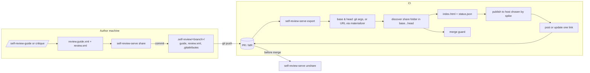

# Plan: Shareable, read-only self-review guide for a GitHub PR or GitLab MR

## Original Work Order

Work order as supplied

> Shareable, read-only self-review guide for a GitHub PR or GitLab MR
>
> ## Goal
> A PR/MR author who already generated a self-review guide (review.guide.xml, optionally review.xml) for their own pre-submit review can share it with reviewers on GitHub or GitLab. The PR/MR gets a link ("click here to see an explanation of this PR") that opens a read-only self-review UI for its diff with the guide's walkthrough: groups, rationales, per-file one-liners, and the overview. Think of it as a CodeRabbit-style explainer without a subscription.
>
> ## Core constraints
> - **Both forges are first-class.** GitHub PRs and GitLab MRs (including self-hosted GitLab) are supported from the start. Build on the existing forge abstraction (`ForgeProvider`, `parseForgeUrl`, the github/gitlab providers via `gh`/`glab`, the materializer) rather than adding forge-specific paths beside it.
> - **No LLM or API token spend in CI.** The guide (and any review.xml) is produced locally by the author through the existing self-review-guide / self-review-critique skills, on their own subscription. CI only renders what the author supplies.
> - **Opt-in per PR/MR.** Nothing is generated or hosted unless the author (or a colleague) attaches the guide to the PR/MR. Candidate mechanisms: a file attached to the description or a later comment/note (the maintainer suggested `gh` for this; verify what `gh` and `glab` can actually attach, since attaching a file may need the web UI or the API, and GitLab has project uploads). Pick one mechanism per forge behind a common discovery interface, document how CI finds it, and decide which comment wins if several have files attached.
> - **Read-only.** Reviewers view the guide and any existing comments. No saving, no Finish Review, nothing written back to the forge except the one link to the hosted guide.
> - **Hosting is not decided.** Don't assume a platform. The core deliverable should be a host-agnostic output that any of the candidates below can serve.
>
> ## Key decision: live server vs static artifact
> The maintainer leaned toward "maybe self-review should emit an HTML artifact instead of a server" and left the call to me. Evaluate both against this repo:
> 1. **Run `self-review-serve` remotely.** Today it binds 127.0.0.1 only, checks Host/Origin, requires a per-process capability key delivered in the URL fragment, and exits once a review is submitted. All of that assumes one local reviewer. Exposing it needs a read-only mode, a different trust model, and staying up across many viewers.
> 2. **A static export** (e.g. a `self-review export --read-only` or a build of @self-review/react with the diff, guide and comments baked in). No process, no capability key, and the widest choice of hosts.
> Recommend one, with the trade-offs: large-payload/lazy-loading behavior, image and rendered previews that read reviewed content through the snapshot reader, and what the diff source is (the PR/MR's base...head through the existing remote/materializer path, or a CI checkout).
>
> ## Hosting spike (separate task, time-boxed)
> Include a spike task that explores where the read-only output lives and how the PR/MR link gets posted on each forge, and ends in a short written recommendation. It shouldn't block the core work. Candidates to compare, not a fixed list:
> - GitHub: an Actions artifact, or a per-PR GitHub Pages deploy, plus a bot comment with the link
> - GitLab: a CI job artifact (browsable HTML), per-MR GitLab Pages, or Review Apps (environments), plus an MR note with the link
> - Tugboat preview environments (works with both forges; note that Tugboat stands up and links every listed service on every PR, whether or not it has a guide, so PRs/MRs without one need clean handling)
> - Other preview hosts (Netlify/Vercel/Cloudflare Pages deploy previews)
> For each, cover: cost, setup burden for an adopting project, private-repo access control, self-hosted GitLab compatibility, and whether it needs a static export or can run a server.
>
> ## Out of scope
> - Generating guides or critiques in CI.
> - Posting review comments or replies back to the forge.
> - Building for every host. The plan ships the host-agnostic output plus one reference CI integration per forge (a GitHub Actions workflow and a GitLab CI job), chosen by the spike.
>
> ## Deliverables
> A Strikethroo plan covering: the per-forge attachment/discovery mechanism behind a common interface, the read-only rendering path (server mode or export), the hosting spike and its recommendation, the two reference CI integrations, and tests (unit tests per forge plus an e2e that loads a fixture guide read-only). Any self-review changes the chosen host needs get filed upstream as issues/PRs against e0ipso/self-review.

## Plan Clarifications

| Question | Answer |
| --- | --- |
| How does the author "attach" the guide? | By **committing it to the PR/MR branch**. Research ruled out native attachments: `gh --attach` uploads only images and media; GitHub `.xml` comment attachments cannot be downloaded from Actions in a private repo (browser-session auth); GitLab uploads need a stored PAT or project token (not `CI_JOB_TOKEN`) and GitLab 17.4+. Inline comment payloads hit GitHub's ~65,536-character body limit (measured: guide plus review.xml exceeds it from roughly 100+ files). Secret gists are readable by anyone with the URL, so they leak private-repo content, and GitLab has no token-free equivalent. |
| Where do committed files live? | A fixed `.self-review/` directory at the repository root, with one folder per branch: `.self-review/<branch>/`, so anything left behind is at least organized. There is no config key. A configurable path would need its own base-side lookup (so a PR cannot redirect discovery), validation that it stays inside the repository, and its own documentation and tests. With a fixed path, `share`, `unshare`, `export`, discovery and the merge guard all name one known location. Entries starting with `.` are reserved for local tooling (for example `self-review-stack`'s `.self-review/.stack/`, #192) and are never share folders. |
| How are committed files cleaned up? | A **merge guard** (an ordinary CI status check, not a git feature; a project enforces it by making it required, through GitHub branch protection or GitLab's "Pipelines must succeed") fails while the PR/MR adds or modifies anything under the share directory; an `unshare` command (or plain `git rm`) removes the folder before merge. No bot writes anywhere. The hosted page and its link remain after removal. |
| Can the guide files stay out of the forge diff view? | Yes: `share` writes a nested `.gitattributes` into the branch folder marking its contents `-diff linguist-generated=true gitlab-generated=true`. Whether both forges honor a *nested* `.gitattributes` must be verified; a documented root-level line is the fallback. |
| Live server or static export? | **Static export.** |
| Which CLI hosts the new commands? | `@self-review/serve`: `self-review-serve export`, `share`, `unshare`. Node only, `npx`-able, no Electron in CI. |
| What diff source does `export` use? | Either of two forms. The first is the same git diff arguments `self-review-serve` accepts (for example `$BASE_SHA...$HEAD_SHA` in a CI checkout, or `main...HEAD` for a local preview), handled by the shared startup path. The second is a PR/MR URL, through the existing `parseForgeUrl` → `ForgeProvider` → materializer path (reuses the CI checkout when its remote matches, otherwise a temporary blobless clone). |
| Which "existing comments" are shown? | The committed review.xml only. Forge threads are not fetched. Image attachments (screenshots pasted into a comment, stored in `.self-review-assets/`) are not copied by `share`; a comment that had one shows an "attachment not shared" note where the image would be. |
| Backwards compatibility? | Required, additive only. The accepted edge: `export`/`share`/`unshare` as a first positional become subcommands (as `fetch-comments` is on the desktop), so a git revision or path literally named that needs `self-review-serve -- export`. |

## Executive Summary

An author who has already run `/self-review-guide` (or `/self-review-critique`) locally runs `self-review-serve share`, which copies the guide and optional review.xml into `.self-review/<branch>/`, validates them, and commits them. After the push, CI runs `self-review-serve export`, given either the PR/MR's base and head as git diff arguments (exactly as `self-review-serve` takes them) or the PR/MR URL (materialized through the existing remote machinery). It finds the share folder the PR/MR adds and writes one self-contained, read-only HTML page with the diff, the guided walkthrough and any review.xml comments baked in. The reference CI integration publishes that page, posts or updates a single link on the PR/MR, and runs a merge guard that keeps the share folder off the default branch. Before merging, the author runs `self-review-serve unshare`.

The static export was chosen over running `self-review-serve` remotely. Read-only viewing performs no writes. Every safety property serve has (loopback binding, Host/Origin checks, the fragment-delivered capability key, exit on submission) exists because one local reviewer drives one process. Exposing serve would replace that trust model and require a long-running process on every host. A single HTML file with no network access works on every hosting candidate in the brief: CI artifacts, Pages, Tugboat and deploy previews.

Committing the files (instead of attaching them) is the only mechanism that works the same on both forges, for private repositories and fork PRs, with no size ceiling and no stored token. Discovery is pure git, so the per-forge differences reduce to what the forge abstraction already handles for the URL form: URL parsing, base and head refs, and the clone. The git-arguments form needs no forge code at all. The hosting spike runs alongside and decides where the page lives and how the link is posted. The two reference CI integrations are built from its recommendation.

## Context

### Current State vs Target State

| Current State | Target State | Why? |
| --- | --- | --- |
| A guide sidecar is useful only to the author, in their local app or serve session. | A committed guide renders as a hosted, read-only page linked from the PR/MR. | Reviewers get the walkthrough without installing anything or paying for a review bot. |
| `@self-review/react` has no read-only mode; the composer, edit, reply and Apply controls always render when a host supplies the matching adapter methods. | An additive `readOnly` mode hides every authoring and writing control. | A shared page must not invite comments it can never save. |
| `self-review-serve` serves one local reviewer over loopback HTTP and exits on submission. | `self-review-serve export <git diff args or PR/MR URL>` writes a static page and exits; nothing listens. | Static output fits every candidate host and needs no new trust model. |
| No convention for where a shareable guide lives in a repository. | A fixed `.self-review/` directory with per-branch folders, discovered from the PR/MR's own diff. | Gives a single opt-in signal that CI can read with its own checkout, and one namespace other self-review tooling can build on. |
| Nothing prevents review artifacts from merging. | A merge guard fails while a PR/MR adds or changes share-directory files; `unshare` removes them. | Keeps the default branch clean and avoids cross-PR conflicts. |
| Committed guide files would appear in the forge's diff view. | A nested `.gitattributes` marks them binary/generated, so forges collapse them. | Keeps reviewer attention on the real change. |
| No CI integration exists. | One reference GitHub Actions workflow and one reference GitLab CI job, chosen by a hosting spike. | Adopting projects get a working starting point on each forge. |

### Background

- **Attachment research (2026-11-20).** `gh` has an `--attach` flag on `pr comment`/`edit`, but it is limited to image and media files. GitHub accepts `.xml` attachments through the web UI, but community reports consistently show private-repo attachment URLs returning 404 for `GITHUB_TOKEN`, PATs and App tokens. `glab mr note create --attach` is marked experimental; GitLab upload downloads need Guest+ (`/uploads/:secret/:filename`, 17.4+) and are not on the `CI_JOB_TOKEN` allowlist. `CI_JOB_TOKEN` can read MR notes but cannot post them; `GITHUB_TOKEN` on a fork `pull_request` is read-only. These posting limits feed the hosting spike.
- **Size measurement.** gzip+base64 of realistic guide and review.xml payloads: a 25-file PR with 12 comments uses about 30% of GitHub's comment cap, and a 150-file PR with 40 comments exceeds it. Committing has no such limit.
- **Existing machinery this builds on:** `loadRemoteReview` / `bootstrapRemoteDiff` (`packages/core/src/remote-mode.ts`), the materializer's session-owned refs and clone reuse, the guide parser and reconciliation (`guide-parser.ts`, `guide-loader.ts`, embedded XSD), `parseReviewXml` and the resume importer, `readReviewedContent` (`snapshot-reader.ts`), the ignore filter, `loadConfigWithProvenance`, and serve's Vite client build (`packages/serve/vite.client.config.ts`).
- **Precedent:** the desktop app's `fetch-comments` subcommand (first positional, `src/main/cli-dispatch.ts`) for subcommand routing.

## Architectural Approach

### Share directory convention and discovery

**Objective**: One forge-agnostic way to opt in, locate the shared files, and keep them organized.

- The share directory is the fixed path `.self-review/` at the repository root, defined once as a core constant that `share`, `unshare`, discovery, `export` and tests import. There is no config key, so there is nothing for a PR to redirect and nothing to validate.
- Folder name: the branch name normalized to one path segment (every character outside `A–Z a–z 0–9 . _ -` becomes `-`). One shared normalization function is used by `share`, `unshare` and tests. Git forbids a ref component that starts with `.`, so a normalized branch folder never starts with `.`.
- Entries under `.self-review/` that start with `.` are reserved for local, never-committed tooling output and are never share folders. The first user is `self-review-stack` (#192), which keeps its scratch output in `.self-review/.stack/<prefix>/` behind a self-ignoring `.gitignore` (`*`).
- Folder contents: `review.guide.xml` (required), `review.xml` (optional), `.gitattributes` (written by `share`).
- Discovery is a core module behind a single interface that takes a loaded review session (local git or materialized remote; both carry a `ReviewSourceIdentity` naming the two snapshots compared) and returns one result: *none*, *found* (folder, parsed guide, optional review document) or *invalid* (reason). It:
  - lists files the reviewed diff adds or modifies under `.self-review/`;
  - picks the single non-dot folder touched. More than one touched folder is *invalid* with a message naming them (no guessing);
  - reads both XML files from the **new (reviewed) side** through the snapshot reader (the head commit for a commit range or PR/MR, never the working tree unless the working tree is what is being reviewed), within the existing guide and resume size budgets;
  - validates the guide against the embedded XSD and reconciles it against the diff; parses review.xml with the existing namespace-blind parser and resume importer, carrying its import diagnostics.
- The share directory is always excluded from the exported diff (through the same ignore-filter path the loader already applies), so the guide never lists itself.
- Forge differences stay inside the existing abstraction (URL parsing, PR/MR head refs, base branch lookup with the `git ls-remote` fallback) and apply only to the URL form. Discovery itself has no forge-conditional logic.

### Author commands: `share` and `unshare`

**Objective**: Make committing and removing the shared files one command each, with validation up front.

- Both are first-positional subcommands of `self-review-serve`, routed before serve's own argument parsing. `--` still reaches `git diff` verbatim.
- `share` resolves the guide and review.xml the way the app does: the configured `output-file` and `guide-file`, or explicit flags. It requires a guide, validates it (and review.xml if present) against the XSDs, and refuses an invalid file. It also refuses a detached HEAD.
  - It writes into `.self-review/<branch>/`, replacing that folder's previous contents, plus the nested `.gitattributes` (`* -diff linguist-generated=true gitlab-generated=true`).
  - It stages exactly those paths and creates one commit with a fixed Conventional Commits message.
  - review.xml image attachments are not copied. `share` reports how many comments reference one.
- `unshare` removes `.self-review/<branch>/` and commits the removal with a fixed Conventional Commits message. It is a no-op with a message when the folder is absent.
- Neither command pushes, amends, or touches files outside the branch folder. Both refuse to commit when other changes are already staged, so they never sweep unrelated work into their commit.
- Policy: these are new sanctioned writes inside the repository. They sit alongside the Apply exception and are documented as such in AGENTS.md (see Documentation).

### Read-only mode in `@self-review/react`

**Objective**: Render the full review UI for viewing only, as an additive, opt-in prop.

- New optional `readOnly` prop on `ReviewPanel` (and the provider props it forwards to), defaulting to today's behavior.
- When set, the UI renders no comment composer, no file-level or line-level "add comment" affordance, no drag-to-select, no edit, delete or reply, no suggestion Apply or destination picker, and the `f` comment-hint key is inert. Existing comments, replies, suggestions (as diffs), severity, confidence and author badges render as they do today.
- Guided/Flat toggle, file tree, search, expand/collapse, theme, find, `g`/`j`/`k` navigation, rendered previews, and viewed checkboxes remain. Viewed state is in-memory only and is never persisted.
- No new browser storage, consistent with the "no localStorage" rule.

### Static export: `self-review-serve export`

**Objective**: Produce one host-agnostic, self-contained page for a PR/MR, plus a machine-readable status for CI.

- Input, one of two forms:
  - **Git diff arguments**, exactly as `self-review-serve` accepts them (same parsing, `--` rule, `.self-review.yaml` `default-diff-args` handling and project-config restrictions), loaded through the shared startup path in `packages/core/src/startup.ts`. In CI this is typically `$BASE_SHA...$HEAD_SHA` from the checkout, which needs no forge CLI; locally it lets an author preview the page before pushing.
  - **A GitHub PR or GitLab MR URL** as the first argument, parsed by `parseForgeUrl`, loaded through `loadRemoteReview` under a `RemoteLifetimeOptions` signal, and released through the session's `cleanup()` on every path, as `fetch-comments` does.
- Flags: an output directory, and the status file path.
- Output:
  - `index.html`: one file with the read-only client's JavaScript, CSS and fonts inlined, and the review data embedded as a JSON script element. All `<` characters are escaped, so content cannot close the element. It makes no network requests, carries a Content-Security-Policy meta tag (no `connect-src`, images only from `data:`/`blob:`, scripts only the inlined bundle), and opens correctly from `file://` as well as over HTTP. The client is built as a classic (non-module) script with dynamic imports inlined, because module scripts do not load from `file://`.
  - A status JSON naming the outcome (`none` / `found` / `invalid`), the share folder, the PR/MR head SHA, and the paths under `.self-review/` the PR/MR touches. CI uses it both to decide whether to publish and post, and to drive the merge guard.
  - Exit codes distinguish success (including `none`), invalid input, and failure.
- When discovery returns `none`, no page is written and the exit is successful, so hosts that run on every PR (for example Tugboat) can skip cleanly.
- Data baked into the page: the full diff payload with every file's hunks, the reconciled guide, the review.xml comments (read-only), remote session info, and load and import diagnostics.
- **Large payloads:** the export does not truncate. When the payload crosses the existing `max-files` / `max-total-lines` thresholds, the page's adapter still runs large-payload mode (sections start collapsed) and serves each file's hunks from the embedded data through `loadFileContent`, so the in-browser memory and render behavior matches the other front ends. The fixed input budgets still apply and surface as diagnostics, never as a silently shorter review.
- **Previews:** Markdown, HTML and SVG previews work from diff lines as they do today. Raster images in the diff are read at export time through `readReviewedContent` (the reviewed side, e.g. the PR/MR head commit), within the existing per-image and total budgets, and are embedded as data URIs; an image over budget shows the existing error state.
- **Not available in the export:** context expansion (the adapter omits `expandContext`), Apply, saving, and comment attachments (shown as "attachment not shared").
- **Build:** a second client entry in `packages/serve/src/client/` with a static adapter over the embedded data, and a second Vite build configuration producing the inlinable bundle into `dist/`. No new runtime dependency is planned. If inlining needs a build plugin, it must be called out for review before it is added.

### Merge guard and link posting (reference CI)

**Objective**: Keep shared files off the default branch and give reviewers one stable link, on each forge.

- Both reference integrations:
  1. run `export` for the PR/MR;
  2. on `found`, publish the page to the host the spike recommends and create or update a single marked link comment or note (never a second one);
  3. on `none`, do nothing;
  4. fail a separately named merge-guard check whenever the status lists touched share-directory paths.

  A later push that removes the folder makes the guard pass and leaves the earlier link and page in place.
- GitHub: an Actions workflow. Fork PRs are handled in whatever way the spike settles; the documented options are a two-stage `pull_request` → `workflow_run` split, or `pull_request_target` that never executes PR code. GitLab: a CI job (including self-hosted). Posting a note needs a project access token secret, because `CI_JOB_TOKEN` cannot post.
- The reference files live in the repository as documented examples. They are not wired into self-review's own CI.

### Hosting spike

**Objective**: Decide where the page lives and how the link is posted, without blocking the core work.

- Time-boxed and independent of the export, read-only and share work.
- Compares: GitHub Actions artifacts (including whether a single unarchived HTML artifact can be viewed in the browser), per-PR GitHub Pages; GitLab browsable job artifacts, per-MR Pages, Review Apps/environments; Tugboat (handling PRs without a guide, given it builds every PR); Netlify, Vercel and Cloudflare Pages deploy previews.
- For each: cost, setup burden for an adopting project, private-repo access control, self-hosted GitLab compatibility, fork PR behavior, the permissions needed to post the link, and confirmation that a static page suffices.
- Also verifies on real GitHub and GitLab PRs/MRs that the nested `.gitattributes` collapses or hides the share folder; if not, the recommendation documents the root-level fallback line.
- Ends in a short written recommendation in `docs/`, naming one host per forge for the reference integrations.

## Risk Considerations and Mitigation Strategies

Technical Risks

- **Shared files merge to the default branch**: the guard is only as strong as the project's branch protection.
    - **Mitigation**: per-branch folders keep any leftovers organized and conflict-free. The guard only fails on files the PR/MR itself adds or changes, so leftovers never block other PRs. Documentation recommends making the guard a required check.
- **Stale guide after later pushes**: the guide was written against an earlier head.
    - **Mitigation**: existing reconciliation drops guide paths absent from the diff and puts new files in "Everything else"; the page shows the head SHA it was exported for.
- **Untrusted content from fork PRs rendered on a hosting origin**: guide and review.xml text is attacker-controlled on public repositories.
    - **Mitigation**: existing passive-content sanitizing and strict Mermaid apply unchanged. The export adds a CSP with no network access, and data is embedded as escaped JSON, never as markup. The share location is fixed, so a PR cannot redirect discovery.
- **Single-file page size for very large PRs**: the bundle (including Mermaid and Prism) plus every hunk can make a large HTML file.
    - **Mitigation**: the existing input budgets bound the data, large-payload mode keeps rendering lazy, and the spike checks the chosen hosts' size limits.
- **Classic-script bundle**: inlining dynamic imports (Prism languages, Mermaid) may grow the bundle or need build changes.
    - **Mitigation**: keep it a separate export entry so the serve client is unchanged. Any new build dependency is called out for review.
- **Nested `.gitattributes` not honored by a forge**:
    - **Mitigation**: the spike verifies it on both forges; the documented root-level line is the fallback.

Implementation Risks

- **Subcommand routing changes serve's argument handling**: a first positional `export`/`share`/`unshare` no longer reaches git.
    - **Mitigation**: accepted edge (matches `fetch-comments`). Unit tests pin that `--` still passes these words to git, and the README states it.
- **Read-only mode misses a control**: an authoring affordance leaks into the shared page.
    - **Mitigation**: component tests assert the absence of each control under `readOnly`, and the e2e asserts no composer or Apply appears.
- **CI posting permissions differ per forge and per fork status**:
    - **Mitigation**: settled by the spike before the reference integrations are written. Integrations post or update one marked comment, so reruns never duplicate.

Integration Risks

- **Changes to shared core affect both existing front ends**: discovery and export reuse core's remote and loader paths.
    - **Mitigation**: discovery is a new core module consumed only by the export. Existing handler behavior is unchanged, and the full unit and e2e suites gate the change.

## Success Criteria

### Primary Success Criteria

1. `self-review-serve share` commits a validated guide (and optional review.xml) with a nested `.gitattributes` into `.self-review/<branch>/`, and refuses an invalid guide, a detached HEAD, or a pre-staged index. `unshare` removes the folder in one commit.
2. `self-review-serve export`, given a `base...head` commit range, a GitHub PR URL, or a GitLab MR URL (including a non-github.com/gitlab.com host), produces an `index.html` that, opened from `file://`, shows the PR/MR diff in guided mode with groups, rationales, one-liners and overview, shows review.xml comments read-only, and offers no way to author, save or apply. The page makes no network requests.
3. `export` returns `none` without writing a page when the PR/MR touches no share folder, `invalid` with a reason for an ambiguous or schema-invalid share, and lists touched share paths in its status file in every case.
4. `@self-review/react` keeps its current behavior when `readOnly` is not set, and all existing unit, typecheck, lint and e2e suites pass.
5. A written hosting recommendation exists in `docs/`, and one reference GitHub Actions workflow and one reference GitLab CI job implement export, publish, single-link posting and the merge guard, per that recommendation.
## Self Validation

1. Run `npm run lint`, `npm run format:check`, the five typecheck scripts, `npm run test:unit`, `npm run test:e2e` and `npm run test:e2e:serve`, and confirm every one exits 0.
2. In the scratchpad, create a fixture: a bare repository acting as the remote with a `main` branch and a PR head published at `refs/pull/1/head`, plus a working clone. Add a git `url.<bare-repo>.insteadOf https://github.com/fixture/repo` rewrite (and the GitLab equivalent for `https://gitlab.example.test/group/sub/repo`, with `refs/merge-requests/1/head`) so the forge URLs resolve locally without network access.
3. In the clone, on a feature branch named `feature/demo`, write a guide and a review.xml with two comments, run `self-review-serve share`, and confirm with `git show --stat HEAD` that exactly `.self-review/feature-demo/{review.guide.xml,review.xml,.gitattributes}` were committed. Run `git diff main...HEAD -- .self-review` and confirm git reports the files as binary.
4. Run `self-review-serve share` with a schema-invalid guide and with a file already staged; confirm both refuse and create no commit.
5. Push to the fixture remote, then run `self-review-serve export https://github.com/fixture/repo/pull/1` and the GitLab MR URL, and in the clone `self-review-serve export main...feature/demo`. Confirm each status file reports `found` with the folder and touched paths, that `index.html` exists, and that the commit-range export shows the same files and guide as the URL exports.
6. Open each `index.html` from `file://` with Playwright and take screenshots. Confirm the overview, the named groups, per-file one-liners and both review.xml comments are visible, and that no comment composer, edit, reply, Apply or Finish control exists in the DOM. Record all network requests and confirm there are none other than the `file://` page itself. Confirm `.self-review/` does not appear in the file tree.
7. Run `export` against a PR whose diff touches no share folder; confirm status `none`, no `index.html`, exit 0. Run it against a PR touching two share folders; confirm status `invalid` naming both.
8. Run `self-review-serve unshare`, push, re-run `export`; confirm the status lists no touched share paths (guard would pass) and reports `none`.
9. Run `self-review-serve -- export` in a repo with a path named `export` and confirm it reaches `git diff` as before.
10. Run the reference GitHub Actions workflow locally where feasible (or lint it with `actionlint` if available) and validate the GitLab job with `glab ci lint` if available. Report which of these could not be run.

## Documentation

This plan needs documentation and AGENTS.md updates:

- `packages/serve/README.md`: the `share`, `unshare` and `export` subcommands, their flags, the status file and exit codes, the `--` rule for literal `export`/`share`/`unshare`, and the author workflow end to end.
- Root `README.md`: a short "Share a guide on a PR/MR" section pointing to the serve README and the reference CI files.
- `AGENTS.md`:
  - the fixed `.self-review/` directory, the per-branch convention, and the reservation of dot-prefixed entries for local tooling;
  - the read-only mode of `@self-review/react`;
  - the static export and its client entry in the serve package's structure entry;
  - the new sanctioned writes (`share`/`unshare` commit inside the repository; `export` writes its output directory) in the File writes convention;
  - that `export` touches the network only through remote mode for a user-supplied URL; the git-arguments form is fully local.
- `docs/`: the hosting recommendation from the spike, and adopter setup for each reference integration (secrets and permissions, making the guard a required check, the root `.gitattributes` fallback if needed).
- `.agents/skills/self-review-guide/SKILL.md` and `self-review-critique/SKILL.md`: one line in the closing instructions pointing authors to `self-review-serve share` when the diff belongs to a PR/MR.

## Resource Requirements

### Development Skills

- TypeScript across `packages/core`, `packages/react` and `packages/serve`; React component work in the existing shadcn/ui conventions.
- Git internals: reading blobs at a commit, diff filtering, nested `.gitattributes` semantics, committing safely from a tool.
- Vite build configuration for a classic-script, single-file bundle.
- GitHub Actions and GitLab CI, including fork-PR security models and token scopes.

### Technical Infrastructure

- Existing: Vitest, Playwright (webapp and serve tiers), Vite, tsup, git, the forge abstraction.
- Test-only: local bare repositories with `url.<base>.insteadOf` rewrites standing in for GitHub and GitLab remotes.
- Spike: access to a GitHub repository and a GitLab project (ideally including a private one, and a self-hosted GitLab instance if available) to test hosting, link posting and nested `.gitattributes`.

### External Dependencies

- No new runtime dependencies are planned. Any build-time dependency (for example a Vite single-file plugin) must be named in its PR for the user to confirm the package name and source.

## Integration Strategy

- Read-only mode, discovery, `share`/`unshare` and `export` can proceed in parallel with the hosting spike. The reference CI integrations start after the spike's recommendation.
- Tracked in e0ipso/self-review#191.

## Notes

- Out of scope, per the work order: generating guides or critiques in CI, posting review comments or replies back to the forge, fetching forge discussion threads into the page, and integrations for hosts beyond one per forge.
- The brief asked for "one mechanism per forge behind a common discovery interface" and "which comment wins". Committing replaces comment discovery: one git-based mechanism serves both forges, and ambiguity (more than one touched share folder) is reported as `invalid` rather than resolved by guessing.
